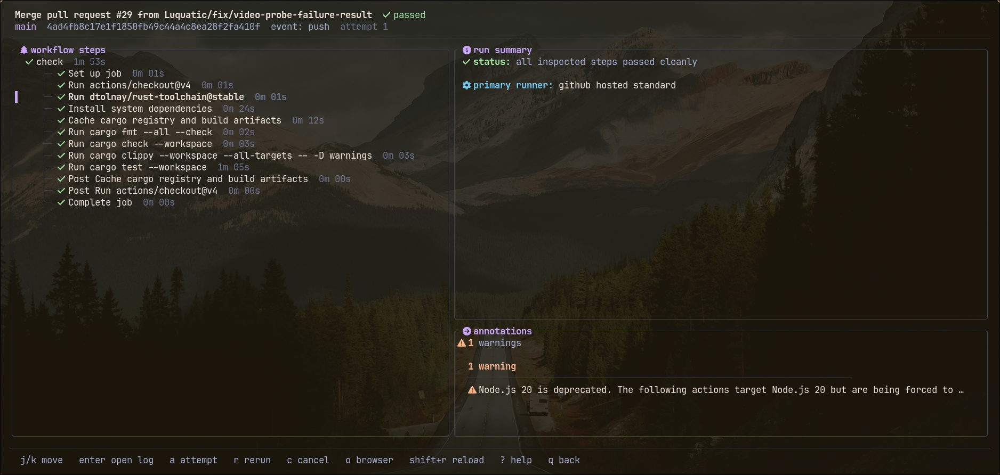

# runline

keyboard-first terminal client for github actions runs.



## what it does

when ci fails, runline finds the error in seconds. runs list failures first. each run opens as a job and step tree with the failed step preselected. logs are searchable with jump to error. failed jobs rerun and stuck runs cancel without leaving the terminal.

- annotations panel collects errors, warnings and notices across the run with file and line. `A` expands the full feed.
- log viewer keeps the runner's original colours, resolved through the active theme.
- `S` saves the visible log to a file. `y` copies the selected line.
- `a` switches run attempts. `T` opens the theme picker.

## install

```bash
cargo install runline
```

or grab a prebuilt archive from the [releases page](https://github.com/programmersd21/runline/releases): linux (glibc and musl, x86_64 and aarch64), macos (x86_64 and aarch64) and windows (x86_64). every release ships a `SHA256SUMS` file.

needs `gh` 2.40.0 or newer, authenticated with `gh auth login`.

## use

```bash
runline                                            # detect repo from current directory
runline --repo octocat/hello-world                 # or pass one explicitly
runline --repo https://github.com/octocat/hello-world
runline --repo git@github.com:octocat/hello-world.git
runline --demo                                     # offline demo with fixture data
```

## keys

global: `?` help · `q` back / quit · `ctrl+c` quit · `ctrl+r` refresh · `T` theme · `j`/`k` move · `g`/`G` top / bottom

dashboard: `enter` open run · `/` filter · `b` branch scope · `tab` switch repo · `r` rerun failed · `c` cancel run · `o` browser

run detail: `enter` open log · `a` switch attempt · `A` expand annotations (`j`/`k` scroll) · `r` / `c` / `o` same as dashboard

log viewer: `/` search (`n` / `N` next / prev) · `e` / `E` next / prev error · `y` copy line · `S` save log · `z` / `Z` fold one / all · `t` timestamps · `w` wrap

## license

mit
